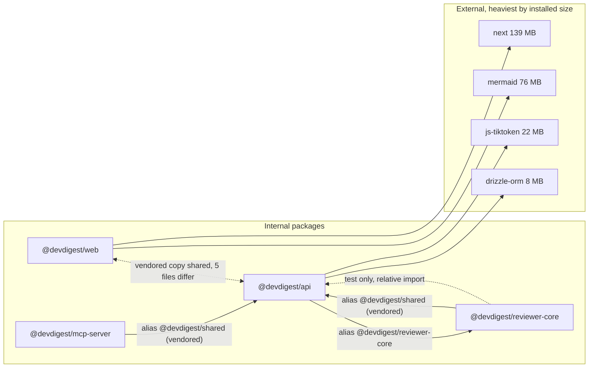

# Report template

Copy this structure. Replace everything in angle brackets. The example mixes real data from
this repository (sizes, the `zod` drift, `@fastify/autoload`, the two lockfiles, the
vendored `shared` copy; 2026-11-12) with one invented P0 (F-01, and the version numbers of
`next` and `mermaid`) so that every tier is shown. Never copy example values into a real
report; always use the data of the current run.

````markdown
# Dependency report — <repo or scope> — <YYYY-MM-DD>

## 1. Scope

| Package | Path | Manager / lockfile | Prod deps | Dev deps |
|---|---|---|---|---|
| @devdigest/api | `server/` | pnpm / `pnpm-lock.yaml` | 23 | 9 |
| @devdigest/web | `client/` | pnpm / `pnpm-lock.yaml` | 15 | 13 |
| @devdigest/reviewer-core | `reviewer-core/` | pnpm + npm / two lockfiles | 2 | 4 |

This repository is not a workspace: packages share code through tsconfig path aliases and
vendored copies. <State whichever of internal/external, size and static-analysis limits apply.>

**Method and limits**
- Ran `node .claude/skills/dependency-checker/scripts/collect.mjs` on <date>.
- Sizes are installed file sizes of each declared package, not bundle sizes.
- Not checked: outdated versions, known vulnerabilities (no network).
- Low-confidence results are marked in the findings table.

## 2. Dependency graph



**Reading the graph:** solid arrow = import through a public alias entry; thick arrow
(`==>`) = deep alias or relative import into another package; dotted arrow = test only or
vendored copy.

## 3. Size breakdown

| Package | node_modules | Heaviest dependencies (installed size) |
|---|---|---|
| @devdigest/web | 590.0 MB | next 139.0 MB (prod), mermaid 76.0 MB (prod), lucide-react 29.0 MB (prod) |
| @devdigest/api | 200.0 MB | js-tiktoken 22.0 MB (prod), drizzle-orm 8.0 MB (prod), drizzle-kit 8.0 MB (dev) |
| @devdigest/e2e | not installed | declared only |

**Heaviest dependencies repo-wide**

| # | Dependency | Package | Version | Size | Section |
|---|---|---|---|---|---|
| 1 | next | web | 15.0.3 | 139.0 MB | prod |
| 2 | mermaid | web | 11.4.0 | 76.0 MB | prod |

## 4. Findings & Priorities

| ID | Tier | Where | Finding | Recommendation | Effort | Confidence |
|---|---|---|---|---|---|---|
| F-01 | P0 | `server/src/services/review-service.ts:12` | Imports `reviewer-core/src/pipeline.js` by relative path, bypassing the public entry | Import from `@devdigest/reviewer-core` | S, 10 min | high |
| F-02 | P1 | `zod` in 4 packages | `^4.2.0` in mcp-server, `^3.24.1` elsewhere (major drift) | Align to `^3.24.1`, or plan a zod 4 migration | M, 2 h | high |
| F-03 | P1 | `server/package.json` | `@fastify/autoload` is declared but only mentioned in a comment | Remove it after confirming nothing loads it by string | S, 10 min | medium |
| F-04 | P2 | `reviewer-core/test/run.test.ts:2` | Test imports `server/src/adapters/mocks.js` | Move the mock into a shared test helper | M, 1 h | high |
| F-05 | Info | `@devdigest/shared` | Vendored copy in `client/` and `server/`, documented in `CLAUDE.md` | None | — | high |

### F-01 · P0 · Relative import across packages

- **Evidence:** `server/src/services/review-service.ts:12` → `../../reviewer-core/src/pipeline.js`
- **Why it matters:** the import bypasses `@devdigest/reviewer-core`, so renaming or moving
  `pipeline.js` breaks `server` with no type error from the alias.
- **Action:** replace the import with `import { ... } from '@devdigest/reviewer-core'`
  and export the symbol from `reviewer-core/src/index.ts` if it is missing. This is a
  recommendation to apply after review.
- **Effort:** S, about 10 minutes.

### F-03 · P1 · Unused runtime dependency (medium confidence)

- **Evidence:** no import of `@fastify/autoload` under `server/`; the only mention is the
  comment in `server/src/modules/index.ts:23`.
- **Why it matters:** about 1 MB of install weight and a package that looks used but is not.
- **Action:** `pnpm --dir server remove @fastify/autoload`, to run after confirming no
  string-based loading. Do not run it as part of this report.
- **Effort:** S, about 10 minutes.

## 5. Summary

1. **Fix the P0 first.** `server` reaches into `reviewer-core` by relative path (F-01).
2. **Align `zod`.** One package is on a different major version (F-02).
3. **Remove one unused runtime package.** `@fastify/autoload` in `server` (F-03).
4. **Size is concentrated in two packages.** `web` holds most of the weight (`next`,
   `mermaid`); no single removal there is a quick win.

**Next action (under 2 minutes):** open `server/src/services/review-service.ts` at line 12
and look at the import path.
````

## Mermaid conventions

- `flowchart LR`, packages in an `internal` subgraph, external packages in an `external`
  subgraph.
- Node ids are short and stable (`api`, `web`, `core`); the label is the package name.
- Edge label = kind: `alias <name>`, `deep alias <name>`, `relative import`, `test only`,
  `vendored copy`. Use `-->` for a public alias entry, `==>` for a deep alias or relative
  import into another package, `-.->` for test-only edges and vendored copies.
- At most 12 external nodes. Put the label size in the node (`next 139 MB`). Everything
  else goes in the size table.
- Quote every edge label that contains spaces or `@`.
