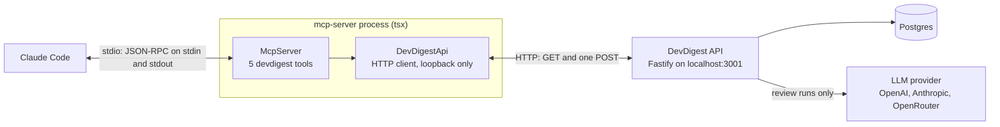

# `@devdigest/mcp-server` — DevDigest for MCP clients

A **local, stdio-only [MCP](https://modelcontextprotocol.io) server**. Claude Code
starts it from the repo's [`.mcp.json`](../.mcp.json) and gets five `devdigest_*`
tools: list the configured reviewers, run one on a pull request, read findings,
read a repository's conventions, and read a pull request's blast radius. Every tool is a
thin wrapper over the already-running DevDigest API on `http://localhost:3001`;
the server never touches Postgres and never imports anything from `server/` at
runtime.

| | |
|---|---|
| Transport | stdio only (newline-delimited JSON-RPC). No Streamable HTTP, no auth |
| SDK | the official TypeScript SDK **v2**, `@modelcontextprotocol/server` **2.3.1** (pinned exactly) |
| Zod | **Zod 4** (`^4.2.0`, imported as `zod/v4`). The rest of the repo is on Zod 3; each package has its own lockfile, so the majors do not clash |
| Package manager | **pnpm**, hoisted `node_modules` (see [`.npmrc`](.npmrc)) like `server/` and `client/` |
| Runs from | source, through `tsx` (no build step, no `dist/`) |
| Status | round 1: production code and typecheck only. **Tests, size measurement and the evaluation kit are deferred** — see [Status and known limits](#status-and-known-limits) |

Why a separate package that talks HTTP, instead of reusing `server/` services:
`ReviewService.runReview` starts a review fire-and-forget **inside the process that
received the call** and streams progress over an in-memory bus. A review started
inside the MCP process would be invisible to the web UI's live log and could not
be cancelled from it, and the API reaps every `running` row on boot assuming "a
single API instance per DB", so an API restart would mark MCP-owned runs failed
while they still run. Going through the routes also keeps `getContext()`
workspace scoping and Zod validation for free. The MCP server is simply a second
delivery shell next to the web client.

## Architecture



Inside `src/` (see the file list in [`CLAUDE.md`](CLAUDE.md)):

- [`src/main.ts`](src/main.ts) — the composition root: loads config, builds the one
  `DevDigestApi`, picks the real clock and calls `serveStdio`. Nothing else
  constructs those.
- [`src/server.ts`](src/server.ts) + [`src/instructions.ts`](src/instructions.ts) —
  `createDevDigestMcpServer`, the factory that creates the `McpServer`, passes the
  `instructions` text and registers each tool. It does no I/O, so start-up is fast
  and it doubles as the factory `serveStdio` needs.
- [`src/tools/`](src/tools) — one file per tool plus shared helpers
  (`shared.ts`, `paging.ts`, `findings-view.ts`, `wait-for-run.ts`).
- [`src/api/client.ts`](src/api/client.ts) — the only code that does HTTP;
  [`src/api/resolve.ts`](src/api/resolve.ts) maps `owner/name` + PR number to the
  API's ids.
- [`src/clock.ts`](src/clock.ts) — the only source of time (`Date.now`,
  `setTimeout`), so a test can later swap it.

**Validation path.** The SDK validates arguments against each tool's `inputSchema`
before the handler runs; a bad argument comes back as an ordinary result with
`isError: true` ("Input validation error: Invalid arguments for tool X: …"), not a
JSON-RPC error. On the way out the SDK validates `structuredContent` against the
tool's `outputSchema` (skipped for `isError` results).

**Data path per tool** (API calls in order):

| Tool | API calls | Side effects |
|---|---|---|
| `devdigest_list_agents` | `GET /agents` | none |
| `devdigest_get_findings` | `GET /repos` → `GET /repos/:id/pulls` (first time per PR) → `GET /pulls/:id/runs` → `GET /pulls/:id/reviews` | the API's GitHub PR sync inside `GET /repos/:id/pulls` |
| `devdigest_get_conventions` | `GET /repos` → `GET /repos/:id/conventions` | none |
| `devdigest_run_agent_on_pull_request` | `GET /repos` → `GET /repos/:id/pulls` (cached) → `GET /agents` → `GET /pulls/:id/runs` (double-run guard) → `POST /pulls/:id/review` (only when that agent has no running run) → `GET /pulls/:id/runs` every 4 s → `GET /pulls/:id/reviews` (when done) | creates run rows and spends LLM tokens; never cancels |
| `devdigest_get_blast_radius` | `GET /repos` → `GET /repos/:id/pulls` (first time per PR) → `GET /pulls/:id/blast` | the API's GitHub PR sync inside `GET /repos/:id/pulls` |

**Identifying a repository and a pull request.** Tools take `repository` as
`"owner/name"` (matched case-insensitively against `Repo.full_name` from
`GET /repos`) and `pull_request_number` as the GitHub PR number. The server
resolves them to the API's UUIDs and caches PR ids in memory for the life of the
process, because `GET /repos/:id/pulls` runs a GitHub sync before it reads and PR
ids are stable. No tool accepts a repo or PR UUID; the only id an agent handles is
`run_id`.

## What loads in a Claude Code session (token cost)

Claude Code defers MCP tool definitions when tool search is on. This repo turns it
on explicitly in [`.claude/settings.json`](../.claude/settings.json)
(`"env": { "ENABLE_TOOL_SEARCH": "true" }`). What that means for this server:

- At session start only the **five tool names** and the server `instructions`
  text are loaded. The full schemas and descriptions are fetched on demand, when
  the model searches for them.
- [`SERVER_INSTRUCTIONS`](src/instructions.ts) is 1,231 characters (Claude Code
  truncates `instructions` and each tool description at 2,048). It says what the
  tools are for, to search for "devdigest", and that the run tool is the only one
  with side effects. Tool descriptions are 170–483 characters.
- `alwaysLoad` is deliberately **not** set in `.mcp.json`; `MAX_MCP_OUTPUT_TOKENS`
  is not set either.
- Names share the prefix `devdigest_`, parameters are unambiguous
  (`pull_request_number`, not `id`), and the server starts without any network
  call (cold start measured at 192–243 ms, see [`insights.md`](insights.md)).

The size of the full `tools/list` and of typical responses has **not** been
measured yet (deferred, see below); the figures above are character counts taken
from the source.

## The five tools

Common input fields: `repository` (`owner/name`, e.g. `acme/payments-api`) and
`pull_request_number` (integer 1–10,000,000). Every successful result carries the
same compact JSON twice: as `structuredContent` (validated against the tool's
`outputSchema`) and serialized into one text block, for clients that only read
text. Errors are one text block with `isError: true`. The example values below are
**illustrative** (shaped like the seeded demo data); ids are made up.

### 1. `devdigest_list_agents`

**Purpose.** List the configured reviewers (agents): name, what each checks,
provider, model, enabled. Read-only (`readOnlyHint: true`, `openWorldHint: false`).

**Inputs.** `response_format`: `"concise"` (default) or `"detailed"`. Detailed adds
`strategy`, `ci_fail_on`, `repo_intel`, `version` and allows a longer description
(≤ 1,000 chars instead of 200).

**Output.** `{ agents: [...], total, message }`. Enabled reviewers first, then by
name. It never returns `id`, `system_prompt` or `output_schema`. With no reviewers,
`message` is "No reviewers are configured. Create one on the Agents page in
DevDigest.".

Call: `{}`

```json
{
  "agents": [
    { "name": "General Reviewer", "description": "Reviews a PR diff for bugs, correctness, and clarity.", "provider": "openrouter", "model": "deepseek/deepseek-v4-flash", "enabled": true },
    { "name": "Security Reviewer", "description": "Flags secrets, injection, SSRF and the lethal trifecta before merge.", "provider": "openrouter", "model": "deepseek/deepseek-v4-flash", "enabled": true }
  ],
  "total": 2,
  "message": null
}
```

### 2. `devdigest_run_agent_on_pull_request`

**Purpose.** Start one review of one reviewer on one pull request and wait for the
result. The only tool with side effects: it spends LLM tokens. It is the explicit
equivalent of `POST /pulls/:id/review`; a review is never started any other way.
Annotations: `readOnlyHint: false`, `destructiveHint: false`,
`idempotentHint: false`, `openWorldHint: true` — so a client keeps asking for
confirmation. This repo adds it to no allow-list.

**Inputs.** `repository`, `pull_request_number`, `agent_name` (1–200 chars,
trimmed, matched case-insensitively against the names from `devdigest_list_agents`).

**Output.** `{ run_id, agent_name, repository, pull_request_number,
pull_request_title, status: "done" | "running", started_new_run, elapsed_seconds,
verdict, score, summary, finding_counts, findings_total, top_findings, next_step }`.
When `done`, `summary` is ≤ 300 chars and `top_findings` holds at most 5 items and
2,000 characters (severity, category, title ≤ 160, file, lines); dismissed findings
are neither counted nor listed. The full list is one `devdigest_get_findings` call
away. `failed`, `cancelled`, a deleted run and API errors are `isError` results
without `structuredContent`. How the wait works: [next section](#how-the-run-tool-waits).

Call:

```json
{ "repository": "acme/payments-api", "pull_request_number": 482, "agent_name": "Security Reviewer" }
```

Result when the review finished inside the limit:

```json
{
  "run_id": "0b6f2f0e-6a1c-4c53-9d5e-3c1f8a7b2d41",
  "agent_name": "Security Reviewer",
  "repository": "acme/payments-api",
  "pull_request_number": 482,
  "pull_request_title": "Add rate limiting middleware",
  "status": "done",
  "started_new_run": true,
  "elapsed_seconds": 12,
  "verdict": "request_changes",
  "score": 61,
  "summary": "Solid middleware approach, but a Stripe secret key is committed in plaintext …",
  "finding_counts": { "CRITICAL": 1, "WARNING": 1, "SUGGESTION": 0 },
  "findings_total": 2,
  "top_findings": [
    { "severity": "CRITICAL", "category": "security", "title": "Hardcoded Stripe secret key in commit", "file": "src/config.ts", "start_line": 12, "end_line": 12 },
    { "severity": "WARNING", "category": "perf", "title": "N+1 query in user list endpoint", "file": "src/api/users.ts", "start_line": 45, "end_line": 52 }
  ],
  "next_step": "All 2 findings are listed. For rationale and suggestions call devdigest_get_findings with run_id 0b6f2f0e-6a1c-4c53-9d5e-3c1f8a7b2d41 and response_format \"detailed\"."
}
```

Result when the limit was reached first (`status: "running"`, counts `null`,
`top_findings: []`): `next_step` is "The review is still running on the DevDigest
server and has NOT been cancelled. Do not call devdigest_run_agent_on_pull_request
again for this pull request and reviewer — that would start and pay for a second
review. Call devdigest_get_findings with run_id <id> in about a minute."

### 3. `devdigest_get_findings`

**Purpose.** Read the stored result of a review run: verdict, score and findings
with file and line, most severe first. Read-only; `openWorldHint: true` because the
text is LLM-written and the PR sync can reach GitHub.

**Inputs.**

| Field | Type | Default | Meaning |
|---|---|---|---|
| `repository`, `pull_request_number` | common | — | which pull request |
| `agent_name` | string 1–200 | — | only runs of this reviewer (case-insensitive) |
| `run_id` | UUID | — | a specific run; omit for the **latest completed** run |
| `min_severity` | `CRITICAL` \| `WARNING` \| `SUGGESTION` | `SUGGESTION` | lowest severity to include |
| `include_dismissed` | boolean | `false` | also return findings the user dismissed |
| `limit` | integer 1–50 | 20 | page size |
| `cursor` | string ≤ 300 | — | `next_cursor` from the previous call |
| `response_format` | `concise` \| `detailed` | `concise` | detailed adds `kind`, `rationale` (≤ 600), `suggestion` (≤ 400) and run cost, tokens, model |

**Output.** `{ repository, pull_request_number, pull_request_title, run, findings,
total_matching, returned, next_cursor, message }`. A finding is `severity, category,
title, file, start_line, end_line, confidence` (2 decimals) and `triage`
(`open | accepted | dismissed`); no finding, review or PR ids. `run` is
`run_id, agent_name, status, ran_at, verdict, score, summary, error`.

Behaviour worth knowing:

- A run that is not `done` (reachable only through `run_id`) is a **normal** result
  with `findings: []` and a `message` ("Review still running … call again in about a
  minute", "Run failed: …", "Run was cancelled; no findings were stored.").
- No completed run for the pull request (or for that `agent_name`) is an `isError`
  result that says how to start one and, when the reviewer has no runs, lists the
  reviewers that do.
- When more findings exist, `message` says "Showing N of M findings, most severe
  first. Pass cursor "…" for the next page, or narrow with min_severity:
  "WARNING"." plus, when the character budget (not `limit`) ended the page, "Response
  size limit reached; use response_format "concise" or a smaller limit.".
- A cursor is bound to its query (run, `min_severity`, `include_dismissed`); reusing
  it with other filters is an `isError`.

Call: `{ "repository": "acme/payments-api", "pull_request_number": 482, "agent_name": "Security Reviewer", "min_severity": "CRITICAL" }`

```json
{
  "repository": "acme/payments-api",
  "pull_request_number": 482,
  "pull_request_title": "Add rate limiting middleware",
  "run": { "run_id": "0b6f2f0e-6a1c-4c53-9d5e-3c1f8a7b2d41", "agent_name": "Security Reviewer", "status": "done", "ran_at": "2026-10-16T09:12:44.000Z", "verdict": "request_changes", "score": 61, "summary": "Solid middleware approach, but a Stripe secret key is committed in plaintext …", "error": null },
  "findings": [
    { "severity": "CRITICAL", "category": "security", "title": "Hardcoded Stripe secret key in commit", "file": "src/config.ts", "start_line": 12, "end_line": 12, "confidence": 0.98, "triage": "open" }
  ],
  "total_matching": 1,
  "returned": 1,
  "next_cursor": null,
  "message": null
}
```

### 4. `devdigest_get_conventions`

**Purpose.** Read the coding conventions DevDigest extracted for a repository.
Read-only, `openWorldHint: false`. It looks the repository up but resolves no pull
request (so no GitHub sync) and never calls the extraction endpoint, which would
spend LLM tokens.

**Inputs.** `repository`; `status` (`accepted` default, `pending`, `all` —
"pending = candidates nobody has confirmed yet"); `category` (optional:
`naming | structure | imports | typing | error-handling | testing | formatting |
other`); `limit` (1–100, default 30); `cursor`; `response_format` (detailed adds
`evidence` as `path:line`, `evidence_snippet` ≤ 200 and `edited`).

**Output.** `{ repository, conventions, counts: { accepted, pending }, total_matching,
returned, next_cursor, message }`. `counts` covers the whole repository, not the
filtered view. Conventions are sorted by confidence, highest first; rule text is
capped at 300 chars. `message` explains an empty result, for example "No accepted
conventions for x/y yet; N pending candidates — pass status: "pending" to see
them. Conventions are accepted on DevDigest's Conventions page."

Call: `{ "repository": "acme/payments-api", "status": "pending", "limit": 1 }`

```json
{
  "repository": "acme/payments-api",
  "conventions": [
    { "category": "error-handling", "rule": "Return typed errors from services instead of throwing strings.", "confidence": 0.91, "status": "pending" }
  ],
  "counts": { "accepted": 0, "pending": 3 },
  "total_matching": 3,
  "returned": 1,
  "next_cursor": "eyJvIjoxLCJrIjoiY3xhY21lL3BheW1lbnRzLWFwaXxwZW5kaW5nfCoifQ",
  "message": "Showing 1 of 3 conventions, highest confidence first. Pass cursor \"eyJvIjoxLCJrIjoiY3xhY21lL3BheW1lbnRzLWFwaXxwZW5kaW5nfCoifQ\" for the next page, or narrow with category."
}
```

### 5. `devdigest_get_blast_radius`

**Purpose.** Read what else a pull request's changes can affect: the changed
symbols, who calls them (`file:line`), and the HTTP endpoints and crons that depend
on them. Read-only, `openWorldHint: false`. It calls `GET /pulls/:id/blast`, which
reads the map the repository index already holds: no model call, no GitHub call of
its own and no re-parse. It is the same map as the Blast radius block on the PR page's
Overview tab. Like the findings tool it resolves the pull request first, so the API's
GitHub PR sync can run on the first lookup per process.

**Inputs.** `repository`; `pull_request_number`. No other argument, so no cursor.

**Output.** `{ repository, pull_request_number, changed_symbols, downstream, summary,
degraded, reason, message }`. `changed_symbols` is `{ name, file, kind }[]`.
`downstream` has one entry per changed symbol that has callers: `{ symbol, callers:
{ name, file, line }[], endpoints_affected, crons_affected }`, highest rank first.
`summary` is the API's one-line count (`symbols: …, callers: …, endpoints: …,
crons: …`). `degraded` and `reason` (`flag_off | index_failed | index_partial |
repo_too_large | no_data`) are copied from the API only when it sends them. Names,
paths, endpoints and crons are sanitised and capped at 200 chars. No ids.

Behaviour worth knowing:

- `message` is `null` for a complete map with callers. Otherwise it is one plain
  sentence: a degraded map gets a text per `reason` (for most of them it says to refresh
  the repository from its Pull requests page in DevDigest, then call again); a map
  with no changed symbols says the changed files declare no indexed symbols; a map
  with symbols but no callers says that nothing calls them.
- The result stays within `MAX_STRUCTURED_CHARS`. When it would not, downstream groups
  are dropped from the end (lowest rank) and then `changed_symbols` is cut, and `message`
  ends with "Response size limit reached: showing a of b changed symbols and c of d
  downstream groups (highest rank first).". The tool has no cursor, so the rest is not
  reachable.
- An unknown repository or pull request is an `isError` result that lists known ones with
  an example; an unreachable API or a timeout is explained like in the other tools.

Call: `{ "repository": "acme/payments-api", "pull_request_number": 482 }`

```json
{
  "repository": "acme/payments-api",
  "pull_request_number": 482,
  "changed_symbols": [
    { "name": "rateLimit", "file": "src/middleware/ratelimit.ts", "kind": "function" }
  ],
  "downstream": [
    {
      "symbol": "rateLimit",
      "callers": [{ "name": "publicRouter", "file": "src/api/public/webhooks.ts", "line": 23 }],
      "endpoints_affected": ["POST /webhooks"],
      "crons_affected": []
    }
  ],
  "summary": "symbols: 1, callers: 1, endpoints: 1, crons: 0",
  "degraded": false,
  "message": null
}
```

## How the run tool waits

`devdigest_run_agent_on_pull_request` is **blocking with a bounded wait**
([`wait-for-run.ts`](src/tools/wait-for-run.ts), the handler in
[`run-agent-on-pull-request.ts`](src/tools/run-agent-on-pull-request.ts)).
`POST /pulls/:id/review` returns immediately and the review runs in a background
promise on the API, with its state durable in the `agent_runs` table — so the
client-side wait can be abandoned at any moment without losing anything.

1. **Resolve first, POST last.** The repository, the pull request and the reviewer
   are resolved before anything is sent. An unknown or duplicated reviewer name
   stops the call with no POST.
2. **Double-run guard.** The API does not stop a second run of the same agent on
   the same PR; each `POST /pulls/:id/review` creates new rows and pays again. So
   the tool first reads `GET /pulls/:id/runs`; if a run of the same agent has
   `status: "running"`, it sends **no POST**, waits on that run and returns
   `started_new_run: false`. Another agent's running run does not block. Otherwise
   it sends exactly one POST (`started_new_run: true`). That POST is the only place
   in the package that changes state; a call that was already cancelled by the
   client never starts a review.
3. **Poll every 4 s.** It sleeps 4 s, then reads `GET /pulls/:id/runs` and looks
   for the run, until the status is `done`, `failed` or `cancelled`. At most 30
   polls in 120 s — about 15 requests a minute, against the API's global limit of
   120 per minute per client (the web UI's own 4 s poll shares it). Two consecutive
   failed polls are tolerated; the third ends the wait with an error that says the
   review may still be running. A run that disappears from the list is reported as
   deleted.
4. **The limit.** The wait ends `DEVDIGEST_RUN_WAIT_MS` after the call started
   (default **120,000 ms**, allowed 5,000–600,000). The clock starts before the
   lookups and the POST, so they count against the limit. Reaching it is **not an
   error**: the result is `status: "running"` with the `run_id` and a `next_step`
   telling the agent not to call the tool again and to read the result with
   `devdigest_get_findings` a minute later.
5. **Never cancels.** There is no cancel or delete method in the API client at all
   (`grep -rnE "method: *'(DELETE|PUT|PATCH)'|/cancel" src/api` prints nothing).
   Hitting the limit, or the client aborting the call, leaves the run going on the
   API, and the web UI shows it live.
6. **Overshoot.** A GET that is already in flight when the limit passes is not
   interrupted, so the answer can arrive up to one HTTP request timeout
   (`DEVDIGEST_MCP_TIMEOUT_MS`, default 10 s) after the limit.
7. **Abort.** If Claude Code cancels the call, the SDK aborts the handler's signal
   and the wait returns at once. Over stdio the SDK then sends no response for that
   request id, so the return value is dropped (observed, see
   [`insights.md`](insights.md)).

| Outcome | Result |
|---|---|
| `done` | normal result: verdict, score, counts, top findings |
| `failed` | `isError`: "The review failed (run <id>): <error ≤ 300>. Fix the cause (for example a missing provider API key in DevDigest Settings) and ask the user before starting it again." |
| `cancelled` | `isError`: "The review was cancelled in DevDigest (run <id>). Ask the user before starting it again." |
| limit or abort | normal result, `status: "running"` |
| run missing | `isError`: "Run <id> no longer exists in DevDigest (it was deleted). Ask the user before starting a new review." |
| 3 failed polls | `isError`: the API-error text + " The review may still be running; check it later with devdigest_get_findings and run_id <id>." |

## Claude Code's timeouts

Facts below are from Claude Code's MCP documentation as researched for the plan
([`plans/mcp-server.md`](../plans/mcp-server.md)); they were **not** re-checked
inside Claude Code here.

- **Idle timeout:** `CLAUDE_CODE_MCP_TOOL_IDLE_TIMEOUT` defaults to 30 minutes for
  stdio servers, so a 120 s wait needs no progress notifications (none are sent).
- **Auto-background:** `CLAUDE_CODE_MCP_AUTO_BACKGROUND_MS` defaults to 120,000 ms
  (Claude Code v2.1.212+; `0` disables). A tool call still running after 2 minutes
  is moved to a background task.
- **The two limits coincide.** `DEVDIGEST_RUN_WAIT_MS` defaults to exactly
  120,000 ms, and the answer can arrive up to one HTTP timeout late, so a slow
  review can meet Claude Code's background threshold. What happens to the result
  then is not verified.
- **OPEN decision (owner):** keep 120 s and document the Claude Code variable, or
  stop the internal wait about 10 s earlier (≈ 110 s, set
  `DEVDIGEST_RUN_WAIT_MS=110000`) so the tool answers before Claude Code
  backgrounds it. The plan recommends the margin; the owner decides after a live
  timing check, which has not been done.

## Error model

- **Handlers never throw.** Every handler runs inside `runTool`
  ([`shared.ts`](src/tools/shared.ts)), which turns anything into an `isError` result
  with a message for the agent. Unexpected exceptions are logged with their stack to
  stderr, and the agent only sees "Unexpected error in the DevDigest MCP server:
  <message ≤ 200>. Details are in the server log (stderr)." — no stack traces, no raw
  exception text.
- **Invalid arguments** never reach a handler: the SDK answers them with an
  `isError` result "Input validation error: Invalid arguments for tool <name>: …".
- **Protocol errors** are only for an unknown tool name.
- **Not errors:** the run tool reaching its limit or being aborted while the review
  runs; `devdigest_get_findings` on a run that is still running.

Messages for API failures (`describeApiError`):

| Case | Message |
|---|---|
| API not reachable | "The DevDigest API is not reachable at <url>. Ask the user to start it with ./scripts/dev.sh from the repo root, then retry." |
| request timeout | "The DevDigest API did not answer within <n> s. Retry once; if it keeps failing, check the API terminal." |
| 404 | the API's message + "Check repository and pull_request_number." |
| 429 | "DevDigest rate limit reached (review starts are limited to 10 per minute). Wait a minute, then retry." |
| other 4xx | the API's message (sanitized, ≤ 300 chars) |
| 5xx | "The DevDigest API failed (<status>): <message> Check the API terminal for details." |

Lookup errors carry a correct-input example, for example "Repository 'x/y' is not in
DevDigest. Known repositories: … Example: {"repository": "acme/payments-api",
"pull_request_number": 482}", "Pull request #N was not found in x/y. Known PRs: …
(newest first).", "No reviewer named 'x'. Available: … Use a name from
devdigest_list_agents.", and the cursor errors ("This cursor is not valid. Repeat
the call without cursor to start from the first page.").

## Size budget

Caps that exist in code ([`shared.ts`](src/tools/shared.ts),
[`paging.ts`](src/tools/paging.ts)), meant to stay far below Claude Code's
10,000-token warning:

- `devdigest_get_findings`: a page of items is cut at 10,000 characters, and so
  that the whole structured result stays within 12,000 (the `detailed` run block
  is subtracted); always at least one item per page; `limit` ≤ 50.
- `devdigest_get_conventions`: items cut at 10,000 characters; `limit` ≤ 100.
- `devdigest_run_agent_on_pull_request`: `top_findings` ≤ 5 items and 2,000
  characters; summary ≤ 300.
- `devdigest_list_agents`: no paging; each name ≤ 200 and description ≤ 200
  (concise) or ≤ 1,000 (detailed). The number of agents is not capped.
- LLM-written text is cut by field: title 200, rationale 600, suggestion 400, rule
  300, snippet 200, error text 300, summary 500 (concise) or 1,500 (detailed). A cut
  ends with " …[truncated]".

**Measurement is deferred** (round 2, plan step 11): there is no script that
measures the tool list or typical responses yet, and no tokenizer dependency (sizes
will be reported in characters with a labelled chars/4 estimate).

## Security notes

- **Loopback only.** `DEVDIGEST_API_URL` must be an `http:` URL on `localhost`,
  `127.0.0.1` or `[::1]`, without credentials, path, query or hash; anything else
  stops the process at start-up. The API itself has no authentication and listens
  on `0.0.0.0` — outside this package's scope.
- **One state-changing request.** The only POST in the package is the review
  start, at most one per call (`grep -rn "startReview" src` shows a single call
  site). Review is never auto-triggered by import or polling.
- **Nothing in `.mcp.json` or `.claude/settings.json` auto-approves the run tool**,
  and `alwaysLoad` is not set.
- **Inputs are validated** by the SDK against Zod schemas (repository regex,
  integer ranges, `z.uuid()` for `run_id`); path segments sent to the API go
  through `encodeURIComponent`; the cursor from the agent is untrusted and decoded
  defensively.
- **Outputs are sanitized.** Finding titles, rationales, convention rules and
  reviewer descriptions come from an LLM or from users; `sanitizeText` strips
  terminal escape sequences and control characters and caps the length, as a guard
  against prompt injection through text the agent then reads. This reduces, and
  does not remove, the risk.
- **stdout is the protocol.** `src/stdout-guard.ts` redirects `console.log/info/debug`
  to stderr; logs are JSON lines on stderr (`DEVDIGEST_MCP_LOG`).
- **No secrets** are read or logged by this package; provider and GitHub keys stay
  in the DevDigest API.

## Running and registering

Prerequisite: the DevDigest API must be running (`./scripts/dev.sh` from the repo
root). Node ≥ 20 (CI uses 22), pnpm.

```sh
cd mcp-server
pnpm install
npm_config_verify_deps_before_run=false pnpm run typecheck   # tsc --noEmit
pnpm start                                                    # tsx src/main.ts — Claude Code normally starts it
```

Registration is the repo-root [`.mcp.json`](../.mcp.json):

```json
{
  "mcpServers": {
    "devdigest": {
      "type": "stdio",
      "command": "mcp-server/node_modules/.bin/tsx",
      "args": ["mcp-server/src/main.ts"],
      "env": {
        "DEVDIGEST_API_URL": "${DEVDIGEST_API_URL:-http://localhost:3001}",
        "DEVDIGEST_RUN_WAIT_MS": "${DEVDIGEST_RUN_WAIT_MS:-120000}"
      }
    }
  }
}
```

It launches `tsx` directly instead of `pnpm exec tsx`: the hoisted layout makes
`node_modules/.bin/tsx` available, it avoids pnpm's own start-up time, and pnpm may
run an implicit install first (`verify-deps-before-run`) whose output would land on
stdout and corrupt the JSON-RPC stream.

In Claude Code: start it from the repo root, approve the project-scoped server when
asked (Claude Code asks before using servers from `.mcp.json`), then check with
`claude mcp list` (`devdigest` should be connected) and `/mcp` (five tools). This
procedure **has not been run** — see the status below.

Environment variables (empty counts as unset; an invalid value stops the process
with one line on stderr and exit code 1):

| Variable | Default | Range / values | Meaning |
|---|---|---|---|
| `DEVDIGEST_API_URL` | `http://localhost:3001` | loopback `http:` origin only | DevDigest API base URL |
| `DEVDIGEST_MCP_TIMEOUT_MS` | `10000` | 1,000–60,000 | timeout of one HTTP request |
| `DEVDIGEST_RUN_WAIT_MS` | `120000` | 5,000–600,000 | how long the run tool waits before returning `running` |
| `DEVDIGEST_MCP_LOG` | `info` | `silent`, `error`, `info`, `debug` | stderr log level |

## Testing

**Tests are deferred (round 2).** There is no test runner and no test file in this
package yet. Round 1 was checked with `tsc` and with throwaway stdio and text checks
that were not committed (see below). CI runs the typecheck only
([`.github/workflows/mcp-server.yml`](../.github/workflows/mcp-server.yml)).

## Evaluation

**The evaluation kit is deferred (round 2):** realistic tasks, a headless
`claude -p` procedure and a transcript summariser (accuracy, number of calls,
tokens, errors) do not exist yet.

## Troubleshooting

- **"The DevDigest API is not reachable at http://localhost:3001"** — the API is not
  running. Start it with `./scripts/dev.sh`, or point `DEVDIGEST_API_URL` at the
  right loopback port.
- **The server fails to start with "Invalid DevDigest MCP server configuration …"**
  — one of the variables is out of range or `DEVDIGEST_API_URL` is not a loopback
  URL; the message on stderr says which.
- **Claude Code reports a broken or hung server, or malformed JSON-RPC** — something
  wrote to stdout. Only MCP messages may go there: use `src/log.ts` (stderr) and keep
  `./stdout-guard.js` the first import of `main.ts`. Never launch the server through
  something that prints to stdout first.
- **Postgres seems down although it ran yesterday** — on this machine the real
  container can live under the Docker `default` context: check
  `docker --context default ps` before concluding it is down (root
  [`insights.md`](../insights.md), 2026-09-29). Do not `docker compose down -v`.
- **A pnpm command fails with `ERR_PNPM_IGNORED_BUILDS` or an install you did not
  ask for** — pnpm runs an implicit install before scripts (`verify-deps-before-run`).
  Prefix with `npm_config_verify_deps_before_run=false` (root
  [`insights.md`](../insights.md), 2026-09-24). `pnpm-workspace.yaml` sets
  `esbuild: false` so that `pnpm install` finishes; `tsx` runs without esbuild's build
  script.
- **The run tool returned `running`** — not a failure. The review continues on the
  API; read it with `devdigest_get_findings` and the returned `run_id`. Do not call
  the run tool again.
- **"No completed review of … yet"** — no run of that pull request (or reviewer) is
  `done`. Run one, or wait for a running one.

## Adding a tool

1. Create `src/tools/<name>.ts` exporting `register<Name>(server, deps)`. Name the
   tool `devdigest_<verb>_<noun>`; give it a short `title` and a description that
   does not repeat the schema (a few hundred characters at most).
2. Define `inputSchema` and, if it returns data, `outputSchema` as `z.object({...})`
   with `import * as z from 'zod/v4'` — never bare `zod`, never raw shapes, never
   `server.tool()`. Property names must match `^[a-zA-Z0-9_.-]{1,64}$`; no root
   `anyOf/oneOf/allOf`. Use unambiguous names (`pull_request_number`, not `id`) and
   reuse `repositoryField`, `pullRequestNumberField`, `responseFormatField`.
3. Set annotations honestly: `readOnlyHint: true` only if it changes nothing.
4. Wrap the handler in `runTool(name, deps, …)` and return through `toolResult`
   (structured + text) or `toolError`. Never throw.
5. Reach data only through `deps.api` (add a method to
   [`src/api/client.ts`](src/api/client.ts); a new GET is fine, anything that
   changes state is a design decision). Use `import type` from `@devdigest/shared`
   only.
6. Return high-signal fields only: no UUIDs the agent does not need, text through
   `sanitizeText` with a cap, lists through `takePage` with a budget and a message
   that says how to narrow the query.
7. Time only through `deps.clock`; no `console.log`.
8. Register it in [`src/server.ts`](src/server.ts), add it to `SERVER_INSTRUCTIONS`
   in [`src/instructions.ts`](src/instructions.ts) if the agent must know about it
   (mind the 2,048-character limit), and update this README and `CLAUDE.md`.
9. Run `pnpm run typecheck`.

## Status and known limits

**What exists.** All five tools, the config and logging, the HTTP client and
resolvers, the run tool's wait and double-run guard, `.mcp.json`, the CI typecheck
workflow and the review-gate routing for this module. `pnpm run typecheck` passes.

**DEFERRED to round 2** (owner decision: "skip tests for now"; they need approval
for `@modelcontextprotocol/client` and the test tooling):

- all tests: unit tests, the stdio smoke test, size-budget test;
- the size-measurement script (plan step 11);
- the evaluation kit (plan step 12).

**What was verified.** Only that the server answers a **hand-written
`protocolVersion: "2025-06-18"` stdio handshake** (`initialize`,
`notifications/initialized`, `tools/list`) in a throwaway script against **fake
APIs**: nothing on stdout but protocol messages, five tools, input schemas with
root `type: "object"` and `$schema` draft 2020-12, exit on stdin EOF, cold start of
about 200 ms (details in [`insights.md`](insights.md)).

**What was NOT verified.**

- The server has **not** been run against the **real DevDigest API** (real
  responses, the seeded data, a real review run, the 4 s poll against a real run).
- It has **not** been run **inside Claude Code**: the relative command path in
  `.mcp.json` (the working directory Claude Code uses for project servers), the
  `${VAR:-default}` expansion, tool search, the 2026-07-28 handshake, whether the
  model sees `structuredContent` or only the text block, and whether
  `readOnlyHint` changes permission prompts are all unconfirmed.
- Claude Code's timeouts and auto-background behaviour above come from its docs,
  not from a run; the ~110 s margin decision is **OPEN**.
- Token cost of the tool list and of responses: not measured.

**Not implemented by design:** Streamable HTTP, authentication, cancelling or deleting runs, accepting or dismissing findings, extracting
conventions, listing pull requests, running every agent at once, progress
notifications, MCP resources and prompts.

**Owner's additional best practices — not yet merged.** The owner will send more
best-practice images; they have not arrived. They are to be merged through the
placeholder section "Owner's additional best practices — to be merged" in
[`plans/mcp-server.md`](../plans/mcp-server.md), which says how.
