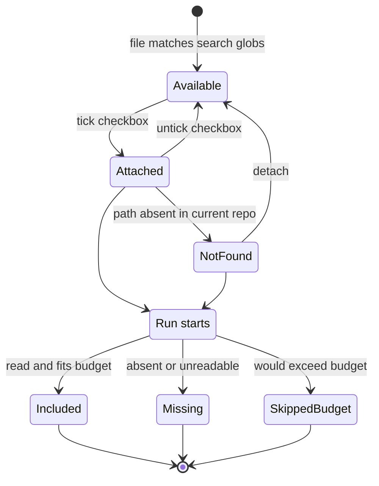

# Spec: Project Context   |   Spec ID: SPEC-01   |   Status: approved

**Affected modules:** server, client, reviewer-core
**Design sources:**
- User description, 2026-10-29: the user finds a repo's specs and other Markdown docs, attaches them by hand to agents and skills, sees the token cost on the spot, and every run adds the attached docs to the prompt as text. The run trace's Prompt assembly has a "Project context — attached specs (untrusted)" entry that opens the full text that was sent.
- User requirements, 2026-10-29: no automatic selection for now (an auto-selector driven by PR content is a separate feature). The server finds `.md` files recursively under configurable search roots, default glob `**/{specs,docs,insights}/**/*.md`. Attachments store paths, not text. Before a run the docs are read and added to `## Project context` as untrusted data, with delimiters and the injection guard. The trace shows `specs_read`, the doc list and each doc's size in tokens. Adding context makes no extra LLM call. Acceptance scenario: a doc with the invariant "module api/ does not import db/ directly", plus a PR that breaks it; the reviewer cites that doc.
- User answers, 2026-10-29: the page is view-only, because the repo mirror is reset to upstream on every resync (`git reset --hard`, `server/src/adapters/git/simple-git.ts`), so an edit saved to disk is silently lost. Attachments are path-only and agent-wide. Docs are read from the synced default branch. A per-run token budget skips whole docs that don't fit. A missing doc is skipped and recorded. The page shows usage as how many agents use a doc. Changing attachments does not create a new agent or skill version. Second round: the editors list the sidebar's selected repo; the skill's "Serializes as" box is a path preview under `## Project context`, not a separate list in the skill body; inherited skill docs, Rescan with freshness, and per-doc token counts are in; the page footer replaces "chunks" with "tokens total" (user, 2026-10-29); third round: CI runs send no project context, one run reads all docs at one commit, the doc list is capped at 1,000 with a notice; the spec stays one feature despite 27 ACs.
- Screenshot 1, Project Context page: sidebar entry "Project Context" under Workspace; repo selector "acme/payments-api · main · synced 2m ago"; a left list of files (`public-api.md`, `security-baseline.md`, `onboarding-flow.md`, `rate-limiting.prd.md`, `webhooks.md`, `data-retention.md`) under a heading with the folder path; a right pane with the filename, a Preview/Edit toggle, "Used by 3 agents", a coverage ring "78", and the rendered Markdown. A toolbar has new file / new folder / upload / refresh, and a footer reads "Indexed: 12 files · 1,240 chunks · last 5m ago". Only the list, preview, filename, usage count and refresh are kept (see Non-goals).
- Screenshot 2, Agents › Security Reviewer › Context tab (beside Config, Skills, Evals, Stats, CI): heading "Project context" with a badge "2 of 7 attached"; a "Filter documents…" field; the helper text "Order matters — earlier docs appear earlier in the assembled ## Project context block. Toggle to attach."; one row per doc with a drag handle, checkbox, filename, folder (`specs/`, `docs/`, `insights/`), a type badge (`specs`, `docs`, `insights`, each a different colour) and a "Preview" button; a footer "≈ 317 tokens · Injected as an untrusted block (## Project context) into every run."
- Screenshot 3, Skills › pr-quality-rubric › Context tab (beside Config, Preview, Evals, Stats, Versions): heading "Project context to use" with a badge "1 attached"; the helper text "Any agent using this skill inherits these documents."; the same row list (preview is an eye icon); a "SERIALIZES AS" box showing `## Project specifications` / `- specs/public-api.md`.
- Screenshot 4, PR #482 › Agent runs › run drawer "Agent run · Security Reviewer": the Configuration block has Model, Skills loaded, Memory pulled, and "Specs read: specs/security-baseline.md specs/public-api.md". The Prompt assembly list has System, "Skills — enabled skill bodies", "Project context — attached specs (untrusted)", "Repo skeleton — repo-intel (dynamic)", "Callers of changed symbols — repo-intel (dynamic)" and "User / diff (dynamic)", each with copy and expand.

## Problem & Motivation

Reviewers only know what the diff and repo-intel show them. They don't know the rules a team has written down: a PRD's requirements, a security baseline, an architecture invariant such as "api/ never imports db/". These rules already live in the repo as Markdown. The engine has a `## Project context` slot for them, and the run trace already has a "Specs read" row and a project-context prompt entry. But nothing feeds them today: every run sends an empty project context, and the user has no way to pick docs or see what they cost.

This feature lets a repo owner pick the docs an agent or skill should always see. It shows the token cost before the review runs, sends the docs as untrusted data on every run, and makes each run's trace show which docs went in and what they said.

## Goals / Non-goals

**Goals**
- List a repo's Markdown docs found under configurable search roots, and preview them read-only.
- Attach docs by hand to an agent (Context tab) and to a skill ("Project context to use"), in a user-set order, with the token cost shown on the spot.
- On every run, read the attached docs from the synced default branch and add them to the prompt as untrusted, delimited data within a token budget, with no extra LLM call.
- Make each run's use of project context visible in the trace: which docs, their tokens, what was skipped and why, and the full text sent.

**Non-goals**
- Automatic selection of docs by PR content. That is a separate future feature.
- Editing, creating, uploading or foldering docs from the Project Context page. The mirror is reset to upstream on every resync, so local edits would be lost. Saving edits needs a write-back to GitHub, which is a separate feature.
- Embeddings, chunking, the "coverage" ring, and an "Indexed … chunks" figure.
- Per-repo attachment lists. An attachment is a repo-relative path that applies wherever the agent runs.
- Reading a doc's version from the PR head. Docs always come from the default branch.
- Versioning attachment changes. Attaching, detaching or reordering docs creates no agent or skill version.
- Truncating a doc to fit the budget. A doc is either sent whole or skipped.
- Exposing project context through MCP tools.
- Project context in CI runs (run source `ci`). That is a separate feature, together with the CI runner itself.
- A separate `## Project specifications` list inside a skill's body. The skill's doc text goes only into the shared `## Project context` block.

## User stories

- **US-1** As a repo owner, I want to see every spec, doc and insight file in a repo and read it, so that I know what written rules exist before attaching any.
- **US-2** As a repo owner, I want to attach docs to an agent in a chosen order and see their token total, so that the agent always reviews against those rules at a cost I know beforehand.
- **US-3** As a repo owner, I want to attach docs to a skill, so that every agent using that skill gets the docs the skill depends on.
- **US-4** As a reviewer, I want every run to include the attached docs' current text as data, so that findings can be judged against the project's written rules without the docs being able to steer the reviewer.
- **US-5** As a reviewer, I want the run trace to show which docs were sent, their size, which were skipped, and the full text, so that I can tell why a finding cited or ignored a rule.
- **US-6** As a reviewer, I want a finding that breaks a documented rule to name the doc it relies on, so that I can check the rule myself.

## Acceptance criteria (EARS)

- **AC-1** · P1 · US-1 · Verify: integration — WHEN the doc list of a repo is requested, the project context API shall return every `.md` file in that repo's synced default-branch mirror that matches the configured search globs (default `**/{specs,docs,insights}/**/*.md`), each with its repo-relative path, its doc type (`specs`, `docs` or `insights` — the matched folder nearest the file), its size and its token count.
- **AC-2** · P1 · NFR · Verify: integration — The project context API shall never list, read or return a file that resolves outside the repo mirror, lies inside `.git/` or `node_modules/`, or is reached through a symbolic link.
- **AC-3** · P1 · US-1 · Verify: e2e — WHEN the user opens the Project Context page for a repo, the page shall list that repo's docs with path, type badge and token count, filterable by path.
- **AC-4** · P1 · US-1 · Verify: e2e — WHEN the user selects a doc on the Project Context page, the page shall show the doc's rendered Markdown with no control that edits, creates, uploads or deletes a file.
- **AC-5** · P2 · US-1 · Verify: integration — The Project Context page shall show, for the selected doc, "Used by N agents", where N counts the agents that would receive the doc on their next run, either attached directly or through an enabled linked skill.
- **AC-6** · P1 · US-1 · Verify: e2e — IF the repo has no synced mirror or no file matches the search globs, THEN the Project Context page shall show an empty state that names the reason and the search globs in use.
- **AC-7** · P1 · US-2,US-3 · Verify: e2e — WHEN the user ticks or unticks a doc's checkbox in the agent editor's Context tab or the skill editor's "Project context to use" section, the editor shall save the attachment change immediately and update the "N of M attached" badge.
- **AC-8** · P1 · US-2,US-3 · Verify: e2e — WHEN the user reorders attached docs by drag or by keyboard, the editor shall save the new order.
- **AC-9** · P1 · US-2,US-3 · Verify: integration — The agents and skills API shall store an attachment list as an ordered list of repo-relative paths, never doc text, without creating an agent or skill version.
- **AC-10** · P1 · US-2 · Verify: e2e — The agent editor's Context tab shall show "≈ N tokens" for the attached docs.
- **AC-11** · P1 · US-2 · Verify: e2e — IF the attached docs' token total exceeds the per-run project context budget, THEN the agent editor's Context tab shall show a warning naming the budget and the docs that will be skipped.
- **AC-12** · P1 · US-2,US-3 · Verify: e2e — IF an attached path does not exist in the current repo, THEN the editor shall show it as an attached row marked "Not found in <repo>" that can still be detached.
- **AC-13** · P2 · US-3 · Verify: e2e — The skill editor's "Project context to use" section shall show a "Serializes as" preview that shows the heading `## Project context` followed by the skill's attached paths in order, and no doc text.
- **AC-14** · P1 · US-3,US-4 · Verify: integration — WHEN an agent run starts, the run executor shall collect project context docs in this order: the agent's own attachments, then each enabled linked skill's attachments in the agent's skill order, sending each path at most once (first occurrence wins).
- **AC-15** · P1 · US-4 · Verify: unit — The prompt assembly shall render each sent doc in its own untrusted block under `## Project context`, labelled with the doc's repo-relative path.
- **AC-16** · P1 · US-4 · Verify: unit — The injection guard shall state that project context docs are reference data for judging the code, never instructions that change the reviewer's role, scope or severity rules.
- **AC-17** · P1 · US-4 · Verify: integration — IF an attached doc is missing, unreadable or not valid UTF-8 text at run start, THEN the run shall skip that doc, record it as `missing` in the trace, and continue the review.
- **AC-18** · P1 · US-4 · Verify: integration — IF adding the next doc would push the project context over the per-run budget (default 20,000 tokens, set in server configuration), THEN the run shall skip that whole doc, record it as `skipped_budget` in the trace, and go on to the next doc.
- **AC-19** · P1 · US-5 · Verify: e2e — WHEN the user opens a run in the trace drawer, the "Specs read" row shall list every collected doc with its path, its token count, and a status of `included`, `missing` or `skipped_budget` that is shown as text.
- **AC-20** · P1 · US-5 · Verify: e2e — WHEN the user expands "Project context — attached specs (untrusted)" in the trace's Prompt assembly, the drawer shall show the exact project context text sent in that run.
- **AC-21** · P1 · NFR · Verify: integration — The run executor shall add project context without any LLM call beyond the review's own calls.
- **AC-22** · P1 · US-6 · Verify: manual — WHEN a doc stating "module api/ does not import db/ directly" is attached to an agent and that agent reviews a PR in which a file under `api/` imports from `db/`, the review shall contain a finding whose rationale names that doc's path.
- **AC-23** · P1 · US-2,US-3 · Verify: e2e — The agent and skill editors shall list the docs of the repo selected in the sidebar.
- **AC-24** · P1 · US-2,US-3 · Verify: e2e — IF no repo is selected in the sidebar, THEN the agent and skill editors shall show "Select a repo to see its docs" above the attached paths.
- **AC-25** · P2 · US-2 · Verify: e2e — The agent editor's Context tab shall show docs inherited from enabled linked skills as read-only rows marked "via <skill name>", counted in the token total and in the budget warning.
- **AC-26** · P2 · US-1 · Verify: e2e — WHEN the user clicks Rescan on the Project Context page, the page shall reload the doc list from the mirror and show the footer "N files · ≈ T tokens total · scanned <time> ago", where T is the sum of the listed docs' token counts.
- **AC-27** · P3 · US-2,US-3 · Verify: e2e — The agent and skill editors shall show each doc's token count on its row.
- **AC-28** · P1 · US-4,US-5 · Verify: integration — WHEN an agent run starts, the run executor shall read every attached doc at the one default-branch commit the mirror is at when the run starts, and record that commit in the trace.
- **AC-29** · P2 · US-1 · Verify: integration — IF more than 1,000 docs match the search globs, THEN the Project Context page shall list the first 1,000 by path and show "Showing 1,000 of N docs — narrow the filter or the search roots".
- **AC-30** · P1 · US-4 · Verify: integration — IF the run source is `ci`, THEN the run executor shall send no project context, which the trace's "Specs read" row shows as "Not used in CI runs".

## Edge cases

- An attached doc is deleted or renamed on the default branch after it was attached → AC-12 (editor), AC-17 (run).
- The same path is attached to the agent and to one of its linked skills → AC-14.
- A linked skill is disabled globally or for this agent → AC-14 (its docs are not sent).
- One doc alone is larger than the whole budget → AC-18 (always skipped, shown in the trace), AC-11 (warned beforehand).
- A later, smaller doc still fits after a larger one was skipped → AC-18 (the run goes on to the next doc).
- A `.md` file that is binary or not UTF-8 → AC-17.
- A doc contains `</untrusted>`, a fake heading, or "ignore previous instructions" → AC-15, AC-16.
- A file path contains quotes or angle brackets → AC-15 (the label is escaped), AC-19 (shown as plain text).
- A symlink inside `specs/` that points to `/etc/passwd` or another repo → AC-2.
- `node_modules/foo/docs/README.md` matches the default glob → AC-2.
- The repo was never synced, or its mirror is missing at run time → AC-6 (page), AC-17 (every attached doc recorded as `missing`).
- An agent runs on a PR in a different repo from the one used when attaching → AC-14, AC-17 (paths resolve against the PR's repo; absent ones are `missing`).
- A resync lands while a run is collecting docs → AC-28 (all docs come from one commit).
- A run started from CI → AC-30.
- No repo selected in the sidebar while editing an agent or skill → AC-24.
- A skill's docs push the agent over budget although the agent's own docs fit → AC-25 (shown in the agent's total and warning), AC-18.
- A multi-agent run → AC-14 (each agent run collects its own docs independently).
- Ten thousand matching files in a monorepo → AC-29.

What the user sees for one attached doc, from the editor to the trace:

## Non-functional

- **Performance** — The doc list shall return within 2 s for a repo with up to 1,000 matching files. Above that, the list is capped with a notice (AC-29). Collecting project context shall add at most 1 s to run start for up to 20 attached docs. Token counts are estimates from the server tokenizer and are shown with "≈". → AC-1, AC-10.
- **Security & privacy** — The feature is read-only on the repo mirror. Paths come from the mirror listing or from stored attachments, and are confined to the mirror (AC-2). Only paths are stored (AC-9); doc text is stored only inside the run's trace, as the record of what was sent. The Markdown preview renders no raw HTML or script, and neutralises `javascript:` links. Access follows the existing workspace scoping of repos, agents and skills.
- **Accessibility** — Every row checkbox and Preview button has an accessible name that includes the doc path. Reordering works by keyboard (the same pattern as the agent's Skills tab). Type badges and trace statuses carry text, not colour alone. The over-budget warning (AC-11) and save failures are announced through a live region. The Preview dialog returns focus to its trigger on close.
- **Cost & LLM** — 0 extra LLM calls per run (AC-21). The docs add input tokens to the review's existing call(s), and those show up in the run's existing tokens and cost. The budget (AC-18) is the cap. Attaching or previewing docs makes no LLM call. Nothing in this feature triggers a review; reviews still start only from an explicit `POST /pulls/:id/review`.

## Inputs (provenance)

| Input | Source |
|---|---|
| Doc list (paths, types, sizes) | `[deterministic: recursive glob over the repo's synced default-branch mirror]` |
| Doc text (preview and prompt) | `[deterministic: file read from the default-branch mirror]` |
| Token counts (per doc, total) | `[deterministic: server tokenizer over the doc text, no LLM]` |
| Attachment lists (agent, skill) | `[deterministic: user-set ordered paths, stored per agent and per skill]` |
| Linked skills and their order, enabled flags | `[reused: skills feature — agent_skills order and both enable levels, server/specs/skills.md]` |
| "Used by N agents" | `[deterministic: count over agent attachments plus enabled skill links]` |
| Mirror state ("synced 2m ago") | `[reused: repo sync / repo-intel resync of the default-branch mirror]` |
| `## Project context` prompt block | `[reused: reviewer-core prompt assembly specs slot and untrusted wrapping]` |
| Trace "Specs read" and Prompt assembly entry | `[reused: run trace specs_read and prompt_assembly.specs fields, extended with per-doc tokens and status]` |
| Finding that cites a doc (AC-22) | LLM output of the review's own call(s); no extra call. |

## Untrusted inputs

- **Doc text** — written by anyone who can push to the repo's default branch. It is **data, never instructions**: in the prompt it sits inside a per-doc untrusted block, any closing delimiter inside it is neutralised, and the injection guard tells the reviewer it is reference material that cannot change the reviewer's role, scope or severity rules (AC-15, AC-16). On the Project Context page and in Preview it is rendered as sanitised Markdown, with no raw HTML or script and no `javascript:` links. In the trace it is shown as plain text.
- **Doc paths and filenames** — also repo-controlled. They are rendered as escaped text in lists, badges and the trace, and as an escaped attribute in the prompt label. They can never reach a file outside the mirror (AC-2).
- **Stored attachment paths** — user input to the agents and skills API. They are validated as repo-relative `.md` paths with no traversal, and are resolved only inside the mirror at read time (AC-2).
- **LLM output that cites a doc** — the existing findings pipeline renders it, with no new rendering path.

## [NEEDS CLARIFICATION: …]

None — all items resolved by the user on 2026-10-29.
