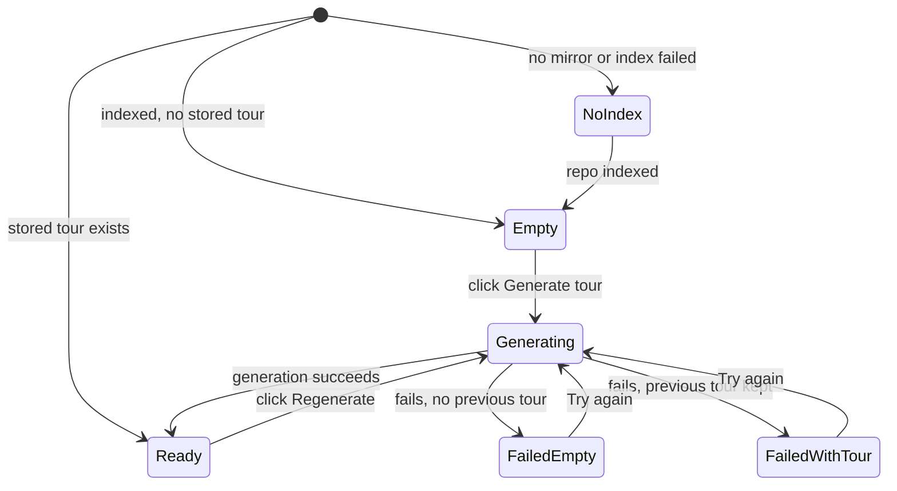

# Spec: Onboarding Tour   |   Spec ID: SPEC-02   |   Status: approved

**Affected modules:** server, client, e2e
**Design sources:**
- User description, 2026-11-03: the feature builds a tour of an unfamiliar repo in five parts — architecture overview, critical paths, how to run locally, a recommended order for reading files, and first tasks. It is the L05 "Onboarding generator" item in the root `README.md` lesson table.
- User answers, 2026-11-03: the tour is generated only by an explicit "Generate tour" / "Regenerate" click and then stored; the files in Critical paths and Guided reading path, and their order, are chosen from the repo index without an LLM, and the LLM only writes the notes plus the Architecture, Run locally and First tasks parts; "Share link" copies the tour page's address in this DevDigest; First tasks are 3–5 LLM-suggested starter tasks grounded in the repo, each naming real files, and a task naming an unknown path is dropped.
- User review, 2026-11-03: accepted "Open" on GitHub at the generation commit and the stale notice; rejected showing the generation's model and cost, fixed list-size caps, and section deep links; fewer than 3 grounded first tasks keeps the survivors; with no critical paths in the index, Critical paths falls back to file rank; the spec stays one feature despite 36 ACs.
- Repo state, 2026-11-03: the starter already has a stored-tour slot per repo, an `Onboarding` contract (sections with kind, title, Markdown body, optional Mermaid diagram, links of label + path), a system prompt for the tour, an "Onboarding Tour" entry in Settings → Feature Models, and index reads for top-ranked files and critical paths. No API route, page or sidebar entry exists. The client address `/onboarding` is already the add-repository screen. The app ships English messages only.
- Screenshot 1, Onboarding Tour page (top): sidebar entry "Onboarding Tour" in the WORKSPACE group between "Pull Requests" and "Project Context"; breadcrumb "acme/payments-api › Onboarding Tour"; title "Onboarding for payments-api" with the repo name highlighted; subtitle "Generated from index of 12,450 files · last refreshed 2h ago"; header buttons "Regenerate" (refresh icon) and "Share link" (link icon); a left "ON THIS PAGE" list of the five sections with the current one marked. Each section is a card with an icon, a title and a collapse chevron. "Architecture overview" shows a paragraph with inline code chips (`src/server.ts`, `src/api/*`, `db`) and a flow diagram (client → server.ts → middleware → redis; middleware → api/public/* → postgres). "Critical paths" shows rows of a file icon, a monospace path, a "— note" (e.g. "src/middleware/auth.ts — Token validation, used by 14 routes") and an "Open" button.
- Screenshot 2, Onboarding Tour page (lower): "How to run locally" shows numbered rows (1–4), each one monospace command line with a trailing comment allowed (e.g. `cp .env.example .env # add OPENAI + STRIPE keys`, `pnpm dev # http://localhost:3000`) and a copy icon button. "Guided reading path" shows numbered steps (1–3), each a monospace path with a one-line reason under it (e.g. "src/server.ts — See the whole request lifecycle in one file"). "First tasks" is listed in the page nav but not shown in either screenshot.

## Problem & Motivation

A reviewer who opens PRs of a repo they have never seen has to work out its shape first: where requests enter, which files everything depends on, how to start it, and where to begin reading. Today DevDigest computes a lot about a repo (file graph, file rank, critical paths, endpoints) but shows none of it as orientation for a human; the onboarding pieces in the starter are unused.

The Onboarding Tour turns the index and the repo's own files into one page with five parts. The file choices come from the index, so they are real and stable; the LLM only explains them and writes the parts that need prose. The tour is generated on request and kept, so reading it costs nothing.

## Goals / Non-goals

**Goals**
- One page per repo with five sections in fixed order: Architecture overview, Critical paths, How to run locally, Guided reading path, First tasks.
- Generate the tour only on an explicit click, with one LLM call, using the "Onboarding Tour" feature model; store it and show it on later visits without a call.
- Choose the files of Critical paths and Guided reading path from the repo index, never from the LLM.
- Show where the tour came from and how old it is, and keep the previous tour when a regeneration fails.
- Let a reviewer copy run commands and the tour's address.

**Non-goals**
- Generating the tour automatically — on page open, on repo import, on sync or after indexing.
- Editing tour text by hand, or keeping a history of earlier tours. A successful regeneration replaces the stored tour.
- Running any command from How to run locally. DevDigest only shows and copies them.
- Public or authenticated share links, or exporting the tour to Markdown/PDF. "Share link" only copies this DevDigest page's address.
- Tours in languages other than English.
- Reading GitHub issues for First tasks.
- Exposing the tour through MCP tools.
- Changing the add-repository screen at `/onboarding`.
- Showing the model or the token cost of a generation on the tour page.
- Fixed size caps for Critical paths and Guided reading path set by this spec; list sizes are a plan decision bounded by the Performance line.
- Links to a single section of the tour; "Share link" copies the page's address only.
- An in-app file viewer; "Open" goes to GitHub.

## User stories

- **US-1** As a reviewer, I want a five-part tour of a repo on one page, so that I understand its architecture before I review its PRs.
- **US-2** As a reviewer, I want the critical files and a reading order chosen from the repo index, so that I start from files that matter and every path I see exists.
- **US-3** As a reviewer, I want numbered run-locally commands I can copy, so that I can start the project without reading every config file.
- **US-4** As a reviewer, I want a few starter tasks tied to real files, so that I have a concrete first change to make.
- **US-5** As a repo owner, I want to generate and regenerate the tour myself and see when and from what it was built, so that I control LLM cost and know whether it is current.
- **US-6** As a reviewer, I want to copy a link to the tour, so that a teammate on the same DevDigest opens the same page.

## Acceptance criteria (EARS)

- **AC-1** · P1 · US-1 · Verify: e2e — The sidebar shall show an "Onboarding Tour" entry in the WORKSPACE group, between "Pull Requests" and "Project Context", that opens the tour page of the repo selected in the sidebar.
- **AC-2** · P1 · NFR · Verify: e2e — The add-repository screen shall stay reachable at its current address with its current content.
- **AC-3** · P1 · US-5 · Verify: e2e — IF the repo has no stored tour, THEN the tour page shall show an empty state that says what the tour contains and offers a "Generate tour" button.
- **AC-4** · P1 · US-5 · Verify: integration — WHEN the user clicks "Generate tour" or "Regenerate", the onboarding API shall make exactly one LLM call, with the provider and model set for "Onboarding Tour" in Settings → Feature Models.
- **AC-5** · P1 · US-5 · Verify: integration — WHEN the tour page is opened, the onboarding API shall return the stored tour, or "no tour", without any LLM call.
- **AC-6** · P1 · US-1 · Verify: e2e — WHEN a stored tour exists, the tour page shall show its five sections in this order: Architecture overview, Critical paths, How to run locally, Guided reading path, First tasks.
- **AC-7** · P1 · US-1 · Verify: e2e — The Architecture overview section shall show a Markdown summary followed by a flow diagram of the main components, when the stored tour has a diagram.
- **AC-8** · P1 · US-1 · Verify: unit — IF the stored architecture diagram cannot be parsed, THEN the Architecture overview section shall show the summary without a diagram and without an error graphic.
- **AC-9** · P1 · US-2 · Verify: integration — The onboarding API shall choose the Critical paths files from the repo index's critical paths and file rank, without an LLM, and use the LLM only for each file's one-line note.
- **AC-10** · P1 · US-2 · Verify: integration — The onboarding API shall choose the Guided reading path files and their order from the repo index, without an LLM, and use the LLM only for each step's one-line reason.
- **AC-11** · P2 · US-2 · Verify: integration — The Critical paths and Guided reading path lists shall contain no test files, config files, migrations or generated files.
- **AC-12** · P1 · US-2 · Verify: e2e — The Critical paths section shall show one row per file with its repo-relative path and its one-line note.
- **AC-13** · P1 · US-2 · Verify: e2e — The Guided reading path section shall show numbered steps, each with a repo-relative path and a one-line reason.
- **AC-14** · P1 · US-3 · Verify: e2e — The How to run locally section shall show numbered commands, each as one line of monospace text with a copy button whose accessible name includes the step number.
- **AC-15** · P1 · US-3 · Verify: e2e — WHEN the user clicks a command's copy button, the tour page shall put exactly that command's text on the clipboard and announce "Copied" through a live region.
- **AC-16** · P1 · US-4 · Verify: e2e — The First tasks section shall show up to 5 tasks, each with a title, a one-line description and the repo-relative path(s) it touches.
- **AC-17** · P1 · US-4 · Verify: integration — IF a first task names a path that does not exist in the repo at the generation commit, THEN the onboarding API shall drop that task before storing the tour.
- **AC-18** · P1 · US-2 · Verify: integration — IF the LLM output links a path that does not exist in the repo at the generation commit, THEN the onboarding API shall drop that link before storing the tour.
- **AC-19** · P1 · US-5 · Verify: e2e — The tour page header shall show "Generated from index of N files · last refreshed <relative time>", where N is the number of files in the index when the tour was generated.
- **AC-20** · P1 · US-5 · Verify: e2e — WHILE a generation for the repo is in progress, the tour page shall show "Generating tour…" with the Generate and Regenerate buttons disabled, also after a page reload.
- **AC-21** · P1 · US-5 · Verify: integration — IF a generation is requested while another one for the same repo is in progress, THEN the onboarding API shall refuse the request and start no LLM call.
- **AC-22** · P1 · US-5 · Verify: e2e — IF a generation fails (provider error, missing API key, timeout or output that fails validation), THEN the tour page shall keep showing the previous tour, if any, and show the failure reason with a "Try again" action.
- **AC-23** · P1 · US-5 · Verify: e2e — IF the repo has no synced mirror or its index has status `failed` or no data, THEN the tour page shall show "Index this repository first" with the Generate and Regenerate buttons disabled.
- **AC-24** · P2 · US-5 · Verify: e2e — IF the index had status `partial` or `degraded` when the tour was generated, THEN the tour page shall show the notice "Built from a partial index".
- **AC-25** · P1 · US-6 · Verify: e2e — WHEN the user clicks "Share link", the tour page shall put the tour page's absolute address on the clipboard and announce "Link copied" through a live region.
- **AC-26** · P2 · US-3,US-6 · Verify: e2e — IF the clipboard cannot be written, THEN the tour page shall show the text it tried to copy in a selected, read-only field.
- **AC-27** · P2 · US-1 · Verify: e2e — WHEN the user activates an entry in "On this page", the tour page shall scroll to that section and move focus to its heading.
- **AC-28** · P2 · US-1 · Verify: e2e — WHEN the user activates a section's header toggle by mouse or keyboard, the section shall collapse or expand and expose its expanded state to assistive technology.
- **AC-29** · P3 · US-1 · Verify: e2e — WHILE the user scrolls the tour page, "On this page" shall mark the section in view as current.
- **AC-30** · P1 · NFR · Verify: integration — The onboarding API shall never send to the LLM the content of `.env` files other than `.env.example` and `.env.sample`, of private-key files, or of files inside `.git/` or `node_modules/`.
- **AC-31** · P1 · NFR · Verify: unit — The tour page shall render every piece of tour text (summaries, notes, reasons, commands, task text, paths) as sanitised Markdown or plain text, with no raw HTML, no script and no `javascript:` links.
- **AC-32** · P1 · NFR · Verify: integration — IF a generation does not finish within 120 s, THEN the onboarding API shall stop it and record the failure reason "timed out".
- **AC-33** · P2 · US-2 · Verify: e2e — WHEN the user clicks "Open" on a Critical paths row, the tour page shall open that file on GitHub, at the commit the tour was generated from, in a new tab.
- **AC-34** · P2 · US-5 · Verify: e2e — IF the repo's indexed commit differs from the commit the tour was generated from, THEN the tour page header shall show "Repo changed since this tour" next to Regenerate.
- **AC-35** · P1 · US-4 · Verify: e2e — IF no first task survives the path check, THEN the First tasks section shall show "No starter tasks could be grounded in this repo — try Regenerate".
- **AC-36** · P2 · US-2 · Verify: integration — IF the repo index has no critical paths, THEN the Critical paths section shall list the index's top-ranked files under the label "by file rank".

## Edge cases

- First visit to a repo that was never toured → AC-3.
- Repo imported but never synced, or index `failed` → AC-23.
- Index `partial` or `degraded` (some files skipped) → AC-24.
- Double click on Generate, or Generate in two tabs at once → AC-20, AC-21.
- User leaves the page during generation and comes back → AC-20 (still shown as generating), AC-5 (finished tour shown once stored).
- Provider down, API key missing, or model times out during Regenerate → AC-22, AC-32 (old tour stays).
- LLM returns an invalid Mermaid diagram → AC-8.
- LLM invents a file path in a link or task → AC-17, AC-18.
- LLM returns fewer than 3 valid first tasks after dropping → AC-16 (the survivors are shown), AC-35 (none survived).
- Index has no critical paths (e.g. a repo without imports between files) → AC-36.
- A critical file is deleted or renamed after the tour was generated → AC-33 (Open still points at the generation commit), AC-34 (stale notice).
- A README contains "ignore previous instructions" or a fake section → AC-31 (rendered as data); see Untrusted inputs.
- Repo with a committed `.env` holding real keys → AC-30.
- A run command is destructive (`rm -rf`, `curl … | sh`) → AC-14, AC-15 (shown and copied only, never run; see Non-goals and Untrusted inputs).
- Tour text contains `<script>` or a `javascript:` link → AC-31.
- Clipboard blocked (insecure origin, browser permission) → AC-26.
- The sidebar's selected repo changes while on the tour page → AC-1 (the entry opens the newly selected repo's tour).

What the user sees on the tour page:

## Non-functional

- **Performance** — Opening a stored tour shall show it within 1 s on a repo with up to 15,000 indexed files (no LLM call, AC-5). A generation shall finish or fail within 120 s (AC-32). The LLM input is bounded so that one generation fits a single call; the bound is a plan decision.
- **Security & privacy** — The feature only reads the synced mirror and the index. Secret-bearing files never reach the LLM (AC-30). Only the generated tour (text, paths, generation time, index file count and status) is stored per repo. Access follows the existing workspace scoping of repos. All tour text is rendered sanitised (AC-31); the diagram renders with Mermaid's strict security level.
- **Accessibility** — Section toggles are buttons with an expanded state (AC-28); "On this page" moves focus to the section heading (AC-27); copy buttons and "Share link" have text names and announce their result through a live region (AC-15, AC-25); "Generating tour…" and generation failures are announced through a live region; the current section is marked with text or `aria-current`, not colour alone.
- **Cost & LLM** — 1 LLM call per click on "Generate tour" or "Regenerate" (AC-4), 0 for opening, scrolling, copying or sharing (AC-5). The model is the "Onboarding Tour" setting in Settings → Feature Models. No agent run is created, so the cost appears in no run record, and the tour page does not show it (Non-goals). Nothing in this feature triggers a review; reviews still start only from an explicit `POST /pulls/:id/review`.

## Inputs (provenance)

| Input | Source |
|---|---|
| Critical paths file list | `[reused: L04 repo-intel index — critical paths and file rank]` no LLM |
| Guided reading path files and order | `[reused: L04 repo-intel index — top files by rank and dependency order]` no LLM |
| Index file count, index status, indexed commit | `[reused: repo-intel index state]` |
| Repo name, default branch, mirror | `[reused: repo sync]` |
| Architecture summary and diagram | LLM output of the one generation call, grounded in index facts and repo files |
| Per-file notes and reading-path reasons | LLM output of the same call, for files chosen by the index |
| Run-locally commands | LLM output of the same call, grounded in the repo's manifests, scripts, compose files, README and env example |
| First tasks | LLM output of the same call, then `[deterministic: tasks naming a path absent from the mirror are dropped]` |
| Path checks on links and tasks | `[deterministic: existence check in the mirror at the generation commit]` |
| Model and provider | `[reused: Settings → Feature Models "Onboarding Tour"]` |
| "last refreshed" time | `[deterministic: time the stored tour was generated]` |

## Untrusted inputs

- **Repo files sent to the LLM** (README, manifests, compose files, env example, code excerpts, paths) — written by anyone who can push to the repo. They are **data, never instructions**: each sits inside an untrusted block, and the system prompt states that text inside those blocks cannot change the task, the sections or the output format. Secret-bearing files are never sent (AC-30).
- **LLM output** (summary, diagram, notes, reasons, commands, first tasks) — validated against the tour shape before storing; links and tasks naming paths absent from the mirror are dropped (AC-17, AC-18). On the page it is rendered as sanitised Markdown or plain text with no raw HTML, script or `javascript:` links (AC-31); the diagram renders in Mermaid's strict mode and an unparseable diagram is dropped (AC-8). Commands are shown verbatim as text and are never executed by DevDigest; copying is the only action.
- **Repo-controlled paths and the repo name** — rendered as escaped text in rows, steps, chips and the title.

## [NEEDS CLARIFICATION: …]

None — all items resolved by the user on 2026-11-03.
