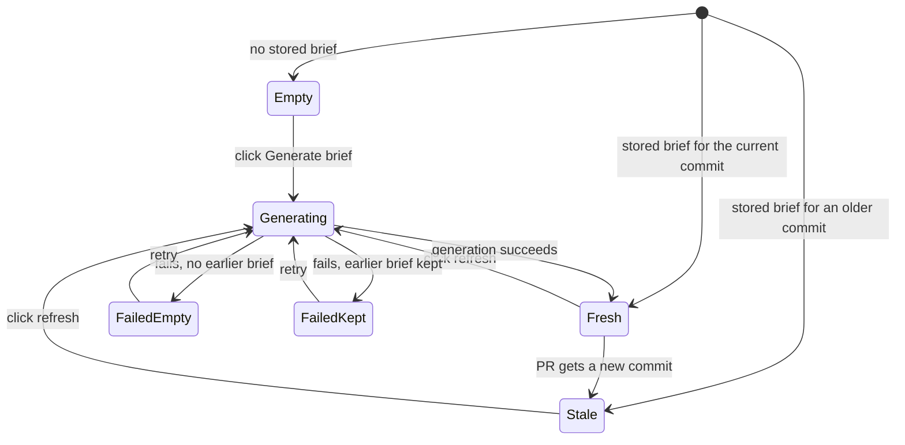

# Spec: PR Brief   |   Spec ID: SPEC-03   |   Status: approved

**Affected modules:** server, client
**Design sources:**
- User description, 2026-11-10: this is the L05 homework. A reviewer who opens someone else's PR "cold" does not know why the change exists, what is risky in it, or which file to read first. The feature gathers what DevDigest already knows into one PR Brief block on the PR's Overview tab and adds two model-written parts, Risk areas and Review focus. The model is called once and receives only precomputed facts — the PR's intent, a summary of its blast radius, diff statistics, the PR description, the linked issue and the attached specs — and never the code of the diff. The brief is generated only by an explicit click, stored, and shown again after a reload; a refresh button generates it anew.
- User description, 2026-11-10 (acceptance criteria): P1 — a PR Brief block with a "Generate brief" button while no brief exists; after generation a summary (what the PR does and why), Risk areas (title and file each) and Review focus (file:line and reason each), with Intent and Blast radius beside them when they exist or a plain statement of what data is missing; no invented file paths; a click on a Review focus item opens Files changed on that file; after a reload the brief is there without a new generation, and the refresh button regenerates it. P2 — the cache is tied to the PR's commit (stale after a new commit), the model comes from the "Risk Brief" setting, exactly one model call per generation, the input stays within a fixed budget and carries no diff code, a click scrolls to the exact line, labels come from the message catalogue, the shared brief contract gains the summary and the Review focus items on both sides. P3 — a verdict/score banner on top, an expandable risk explanation, a click on a risk goes to its file, a "File not in this PR's diff" message, a skeleton while generating.
- User answers, 2026-11-10: (1) the specs fed to the model are the union of the specs attached to all agents of the workspace (and to those agents' enabled skills), deduplicated; (2) the input budget is 8,000 tokens, and when the facts exceed it they are trimmed (specs first) and the brief says what was left out — it does not fail; (3) the latest review's findings (title, severity, file, line — no code) are added to the input facts, the model may cite only lines it was given, and any other Review focus line is set by the system to the file's first changed line.
- Repo state, 2026-11-10: the starter already has an empty per-PR slot for a stored brief, a brief contract (intent, blast radius, risks, history) that has no summary and no Review focus items, a "Risk Brief" entry in Settings → Feature Models, an Intent block and a Blast radius block on the Overview tab, a verdict banner used on the Agent runs tab, and diff statistics and role groups from Smart Diff. No brief API, no brief block, no Generate button and no link from Overview to a file in Files changed exist. The diff viewer cannot open or scroll to a file or line today, and files in collapsed groups or collapsed file cards are not visible until expanded.
- Screenshot 1, PR #482 "Add rate limiting to public API endpoints", Overview tab: a "PR BRIEF" label above a banner with a red "Request changes" verdict, a badge "6 findings · 2 blockers", a one-paragraph summary, a refresh icon button and a "PR SCORE 61" ring, with a small line "$0.014 8.2K→1.3K" under it. Below, in two columns, the Intent block (statement, In scope / Out of scope lists) and the Blast radius block (symbols, callers, endpoints, cron counts; Tree/Graph toggle; a tree of callers and affected endpoints; "Prior PRs touching these files"). Under Intent sits "RISK AREAS": three rows, each with an icon whose colour shows severity, a title ("Auth surface touched", "New dependency: ioredis", "Adds Redis round-trip per request"), a monospace file reference with lines (e.g. `src/middleware/ratelimit.ts:12-18`) and an expand chevron. Under both sits "REVIEW FOCUS — READ THESE FIRST" with a count badge (4) and four lines `file:line — reason` (e.g. `src/config.ts:12 — live Stripe key (sk_live_…) committed in plaintext`).
- Screenshot 2, Files changed tab: "REVIEWER-ORDERED DIFF", "9 files +247 −38", a "Smart order / Original order" toggle, and role groups "Core logic", "Wiring", "Boilerplate" holding file cards (some collapsed, some expanded) with inline finding markers (blocker, warning, suggestion) on lines.
- Screenshots 3 and 4: the same Overview scrolled; they outline the banner area (verdict, summary, score) and the Risk areas and Review focus blocks as the parts this feature adds.
- Screenshot 5, Files changed after a click on a Review focus item: the matching file card (`src/api/public/webhooks.ts`) is outlined and expanded with its lines visible, and an inline finding is open under the flagged lines.

## Problem & Motivation

A reviewer who opens a PR written by someone else has to work out three things before reading code: why the change exists, what in it is risky, and where to start. DevDigest already answers parts of this separately — the PR's intent, its blast radius, the Smart Diff grouping of files by role — but the reviewer must open and connect them by hand, and nothing says which file to read first.

The PR Brief puts these answers on the Overview tab in one block. The facts come from what DevDigest has already computed, and one model call turns them into a short summary, a list of risk areas, and a reading order for the review. The model is given facts and not the code, so the call stays cheap and bounded; every file the brief names is checked against the PR before it is shown, so a reviewer is never sent to a file that does not exist. The brief is made only on request and then kept.

## Goals / Non-goals

**Goals**
- One PR Brief block on the Overview tab: a summary of what the PR does and why, Risk areas, and Review focus, shown together with the existing Intent and Blast radius blocks.
- Generate the brief only on an explicit click, with exactly one model call, using the model chosen for "Risk Brief" in Settings.
- Feed the model facts only: intent, blast radius summary and caller files, diff statistics with role groups, PR title and description, the linked issue, attached specs, and the latest review's findings (no code); keep the input within 8,000 tokens.
- Show only files that are in the PR or in its blast radius, and give each Review focus item a real line.
- Store the brief with the commit it was made for, show it again after a reload without a model call, and show when it is out of date.
- Take the reviewer from a Review focus item to that file in Files changed.

**Non-goals**
- Generating the brief automatically — on PR import, on polling, on opening the Overview tab, or after a review. Review is still started only by an explicit `POST /pulls/:id/review`.
- Sending diff hunks or any lines of changed code to the model.
- Deriving the PR's intent, building the blast radius or running a review as part of generating the brief. A missing input is reported, not produced.
- Regenerating the brief automatically when the PR gets a new commit; the brief is only marked out of date.
- A history of earlier briefs, or editing the brief by hand. A successful regeneration replaces the stored brief.
- The "Prior PRs touching these files" block from L04 and the PR history part of the brief.
- A Graph view or any change to the Intent or Blast radius blocks themselves.
- Exposing the brief through MCP tools.
- Posting the brief to GitHub.
- Briefs in languages other than English.
- Giving the model any tool or file access, or letting it read the diff.
- An in-app source viewer beyond the existing Files changed tab.

## User stories

- **US-1** As a reviewer, I want a PR Brief on the Overview tab that tells me what the PR does and why, so that I understand the change before I read any code.
- **US-2** As a reviewer, I want the risky areas of the PR listed with the file each one concerns, so that I know what to check carefully.
- **US-3** As a reviewer, I want every file named in the brief to really be part of the PR or its blast radius, so that I can trust the brief and am never sent to a made-up path.
- **US-4** As a reviewer, I want a short list of where to start reading, each with file, line and reason, and a click that takes me to it in Files changed, so that I start the review in the right place.
- **US-5** As a reviewer, I want the brief to stay after a reload, to show when it is out of date, and to be regenerated on demand, so that I pay for a model call only when I ask.
- **US-6** As a repo owner, I want the brief to use the model I chose in Settings and a bounded input, so that its cost is predictable and recorded.

## Acceptance criteria (EARS)

- **AC-1** · P1 · US-1 · Verify: e2e — WHILE no brief is stored for the PR, the Overview tab shall show a PR Brief block with a "Generate brief" button.
- **AC-2** · P1 · US-1 · Verify: e2e — WHEN the user clicks "Generate brief", the Overview tab shall show the brief's summary of what the PR does and why.
- **AC-3** · P1 · US-2 · Verify: e2e — WHEN a brief is shown, the PR Brief block shall list its Risk areas, each with a title and at least one file.
- **AC-4** · P1 · US-4 · Verify: e2e — WHEN a brief is shown, the PR Brief block shall list its Review focus items in reading order, each with file:line and a reason.
- **AC-5** · P1 · US-1 · Verify: e2e — The Overview tab shall show the PR Brief block together with the PR's Intent block and Blast radius block.
- **AC-6** · P1 · US-1 · Verify: integration — IF an input among the PR's Intent, its Blast radius, its linked issue and the attached specs is unavailable, THEN the PR Brief block shall show the brief generated from the remaining inputs together with the name of each unavailable input.
- **AC-7** · P1 · US-3 · Verify: integration — The brief shall contain only Risk areas and Review focus items whose files are changed files of the PR or files in its Blast radius.
- **AC-8** · P1 · US-4 · Verify: e2e — WHEN the user clicks a Review focus item, the PR page shall open the Files changed tab with that item's file expanded and in view.
- **AC-9** · P1 · US-5 · Verify: e2e — WHEN the user reloads the PR page after a brief was generated, the Overview tab shall show the same brief without a new generation.
- **AC-10** · P1 · US-5 · Verify: e2e — WHEN the user clicks the refresh button on a shown brief, the Overview tab shall show a newly generated brief in place of the old one.
- **AC-11** · P2 · US-6 · Verify: integration — WHEN a brief is generated, the brief API shall make exactly one model call, with no repeat call when the response is invalid.
- **AC-12** · P2 · US-5 · Verify: integration — IF a generation fails because the model call failed, timed out, returned an invalid response, or has no API key, THEN the PR Brief block shall show the reason with a retry action and keep the previously stored brief, if there is one.
- **AC-13** · P2 · US-6 · Verify: integration — WHEN a brief is generated, the brief API shall use the model chosen for "Risk Brief" in Settings → Feature Models, or that feature's default when none is chosen.
- **AC-14** · P2 · NFR · Verify: integration — The model input of one generation shall not exceed 8,000 tokens, counted with the application's tokenizer, which is an estimate for non-OpenAI models.
- **AC-15** · P2 · NFR · Verify: unit — IF the facts exceed the 8,000-token budget, THEN the brief API shall trim them in this order until they fit — attached specs (whole documents), the linked issue text, the PR description, then the lists of caller files, findings and per-file statistics down to their top entries — and list in the brief what was left out.
- **AC-16** · P2 · NFR · Verify: unit — The model input shall contain no diff hunk bodies and no lines of changed code.
- **AC-17** · P2 · US-4 · Verify: unit — The brief API shall set the line of each Review focus item to a changed line of its file: the cited line when it is a line given to the model in the facts, otherwise the file's first changed line.
- **AC-18** · P2 · US-4 · Verify: unit — IF no changed line is known for a Review focus item's file, THEN the PR Brief block shall show that item with the file and its reason but without a line.
- **AC-19** · P2 · US-5 · Verify: integration — IF the PR's head commit differs from the commit the stored brief was generated for, THEN the PR Brief block shall keep showing the brief with a notice that the PR has new commits.
- **AC-20** · P2 · US-4 · Verify: e2e — WHEN the user clicks a Review focus item that has a line, the Files changed tab shall scroll to that line and mark it.
- **AC-21** · P2 · NFR · Verify: manual — The PR Brief block shall take all its visible labels from the English message catalogue.
- **AC-22** · P2 · NFR · Verify: e2e — WHILE a generation for the PR is running, including after the page was reloaded, the "Generate brief" and refresh buttons shall be disabled and show a busy state.
- **AC-23** · P2 · NFR · Verify: integration — IF a generation request arrives for a PR whose generation is already running, THEN the brief API shall start no second model call.
- **AC-24** · P2 · US-6 · Verify: integration — WHEN a brief is generated, the stored brief shall record the provider, the model, the input and output token counts, and the cost in USD or "unknown" when the model has no price.
- **AC-25** · P2 · NFR · Verify: integration — IF more than 10 generation requests arrive within one minute, THEN the brief API shall reject the extra requests with a rate-limit error and make no model call for them.
- **AC-26** · P2 · NFR · Verify: integration — IF a brief is requested for a PR that belongs to another workspace, THEN the brief API shall answer "not found".
- **AC-27** · P2 · NFR · Verify: unit — The PR Brief block shall render all text that came from the model as plain text, so that HTML or script in it is shown, not executed.
- **AC-28** · P2 · NFR · Verify: unit — The brief generation shall present the PR title, the PR description, the issue text, the spec text and the finding text to the model as quoted content, in a call that offers the model no tools.
- **AC-29** · P2 · US-1 · Verify: integration — IF the PR has no stored changed files, THEN the PR Brief block shall say there are no changed files to brief in place of the "Generate brief" button.
- **AC-30** · P2 · NFR · Verify: manual — WHEN a generation finishes or fails, the PR Brief block shall announce the outcome in a live region.
- **AC-31** · P2 · NFR · Verify: manual — The PR Brief block shall show each risk's severity as a text label or icon with an accessible name as well as by colour.
- **AC-32** · P3 · US-1 · Verify: e2e — WHERE the PR has a review with a verdict, the PR Brief block shall show that verdict, the review's score and its findings and blockers count above the summary.
- **AC-33** · P3 · US-2 · Verify: e2e — WHEN the user expands a risk, the PR Brief block shall show that risk's explanation.
- **AC-34** · P3 · US-4 · Verify: e2e — WHEN the user clicks a risk's file, the PR page shall open the Files changed tab with that file expanded and in view.
- **AC-35** · P3 · US-3 · Verify: e2e — IF the file of a clicked Review focus item or risk is not in the PR's diff, THEN the PR Brief block shall show the message "File not in this PR's diff" on the Overview tab.
- **AC-36** · P3 · US-1 · Verify: e2e — WHILE a generation is running, the PR Brief block shall show a skeleton in place of the brief.
- **AC-37** · P3 · US-6 · Verify: e2e — WHEN a brief is shown, the PR Brief block shall show the generation's input and output token counts and its cost in USD, or "unknown" when the model has no price.
- **AC-38** · P3 · US-5 · Verify: e2e — WHEN a brief is shown, the PR Brief block shall show the short commit the brief was generated for and how long ago it was generated.
- **AC-39** · P2 · NFR · Verify: unit — The brief shall contain at most 6 Risk areas and 5 Review focus items, kept in the order the model gave them.
- **AC-40** · P2 · NFR · Verify: unit — The shared brief contract on the server and on the client shall define the brief's summary and its Review focus items (file, line, reason) identically.

## Edge cases

- First visit to a PR whose brief was never generated → AC-1.
- PR with no Intent derived, an index with no data for the blast radius, no issue linked or unreadable, or no spec attached → AC-6.
- PR never reviewed, so no findings and no banner → AC-17 (lines come from the first changed line), AC-32 (no banner).
- Model names a file that is not in the PR or its blast radius → AC-7.
- Model cites a line that was not given in the facts, or a line outside the file's changes → AC-17.
- Review focus file is binary or too large to have a stored patch → AC-18.
- Facts exceed 8,000 tokens (many specs, long issue, thousands of files) → AC-14, AC-15.
- Review focus file sits in a collapsed group or collapsed file card in Files changed → AC-8.
- Review focus file has been removed from the PR by a later commit → AC-35, AC-19.
- PR gets a new commit after the brief was generated → AC-19.
- Model provider down, API key missing, call times out, or response invalid → AC-12 (previous brief stays), AC-11 (no repeat call).
- Double click on Generate, Generate in two tabs, or refresh while a generation runs → AC-22, AC-23.
- User reloads the page while a generation is running → AC-22 (the busy state shows again), AC-9 (the finished brief shows once stored).
- Model returns more risks or Review focus items than fit → AC-39.
- Many generate requests in a short time → AC-25.
- PR body, issue or spec text contains "ignore previous instructions" or a fake JSON → AC-28, AC-27.
- Model output contains `<script>` or HTML → AC-27.
- PR belongs to another workspace → AC-26.
- PR has no stored changed files (not synced yet) → AC-29.
- Screen reader or keyboard-only user → AC-30, AC-31, AC-8.

What the reviewer sees in the PR Brief block:

## Non-functional

- **Performance** — Opening the Overview tab shall show a stored brief without any model call (AC-9). One generation finishes or fails within 60 s (AC-12). The model input is at most 8,000 tokens (AC-14, AC-15). The brief holds at most 6 Risk areas and 5 Review focus items (AC-39).
- **Security & privacy** — A brief is reachable only through its own workspace (AC-26). Only the generated brief text, its commit, the lists of omitted and unavailable inputs, and the model, token and cost record are stored per PR (AC-24). The model key stays on the server, and the model gets no tools (AC-28). No diff code is sent to the model (AC-16). Generation requests are rate-limited (AC-25).
- **Accessibility** — The Generate and refresh buttons and every Review focus item and risk are reachable and operable by keyboard (AC-8, AC-34); the busy state, the outcome and failures are announced in a live region (AC-22, AC-30); severity is not conveyed by colour alone (AC-31); text and icons meet 4.5:1 contrast.
- **Cost & LLM** — Exactly 1 model call per click on "Generate brief" or the refresh button (AC-11), and 0 for opening, reloading, scrolling or clicking items (AC-9). The model is the "Risk Brief" setting in Settings → Feature Models (AC-13). No agent run is created; the cost is recorded on the brief itself (AC-24). Nothing here starts a review: review runs only through an explicit `POST /pulls/:id/review`, and generating a brief neither derives an intent nor runs a review.

## Inputs (provenance)

| Input | Source |
|---|---|
| PR title, description, head commit | `[reused: stored PR]` |
| Intent (statement, in scope, out of scope, confidence) | `[reused: L03 Intent Layer, stored per PR]` no new call; unavailable when not derived |
| Blast radius summary and caller files | `[reused: L04 blast radius]` read from the index, no LLM; unavailable when the index has no data |
| Changed files with additions and deletions, and their role groups | `[deterministic: stored PR files; roles from L03 Smart Diff path rules]` no LLM |
| Linked issue (title and body) | `[deterministic: the issue the PR description links to, read from GitHub at generation]` not stored; unavailable when GitHub or the issue cannot be read |
| Attached specs | `[reused: Project Context Folder documents attached to any agent or its enabled skills]` union, deduplicated, read from the synced default branch; none attached counts as unavailable |
| Open findings of each agent's latest review (title, severity, file, line) | `[reused: stored review findings]` no code; absent when the PR was never reviewed |
| Summary, Risk areas, Review focus items | LLM output of the one generation call |
| The set of files a brief may name | `[deterministic: changed files of the PR plus files in its blast radius]` |
| First changed line of a file | `[deterministic: stored patch of that file]` used by the system only, never sent to the model |
| Model, provider | `[reused: Settings → Feature Models "Risk Brief"]` |
| Verdict, score, findings and blockers count (banner) | `[reused: latest review of the PR]` |
| Commit the brief was made for; generation time | `[deterministic: head commit and clock at generation]` |

## Untrusted inputs

- **PR title and description, linked issue text, spec text, finding text** — written by other people or by an earlier model run. They are data, never instructions: presented to the model as quoted content, they cannot change the prompt, the model, the budget or what the system does (AC-28). The model has no tools, so text in them cannot make it read or write anything.
- **File paths and lines in the model's response** — treated as claims. A path is kept only if it is a changed file of the PR or a file in its blast radius (AC-7); a line is kept only if it was given to the model, otherwise replaced by the first changed line (AC-17).
- **The model's summary, risk titles, explanations and reasons** — rendered as plain text, never as HTML or Markdown with raw HTML; file references open only the Files changed tab of this PR and never an external address (AC-27).
- **Diff content** — never read by the model (AC-16).

## [NEEDS CLARIFICATION: …]

None open.
